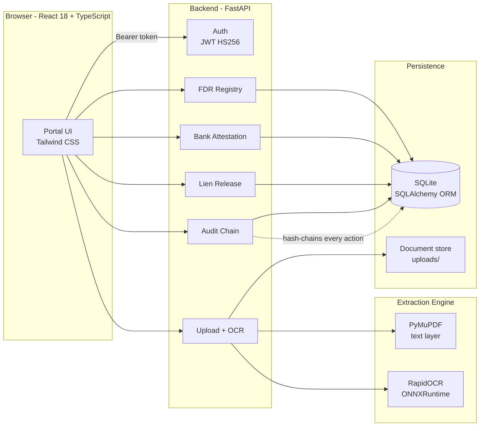
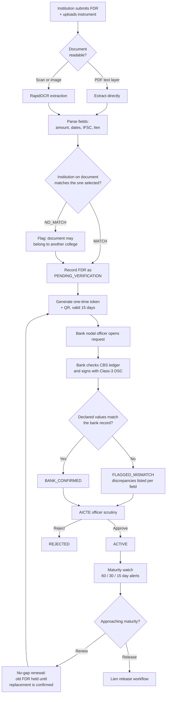
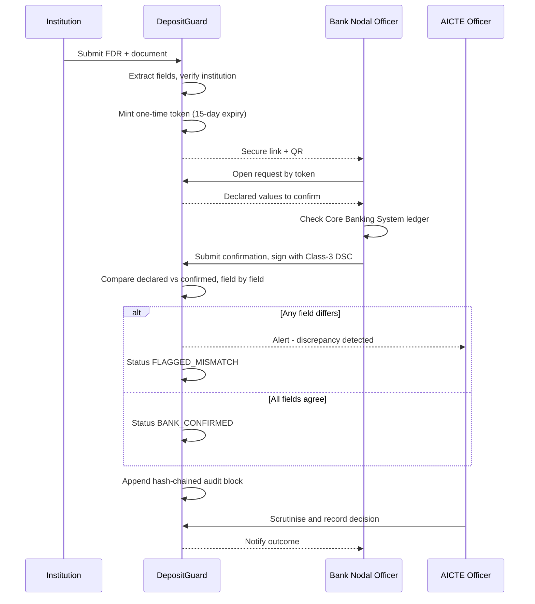
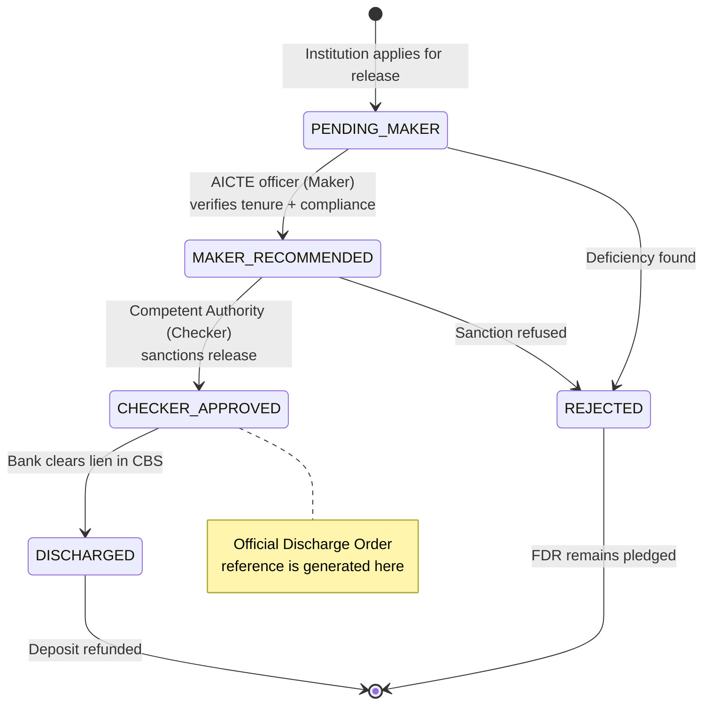
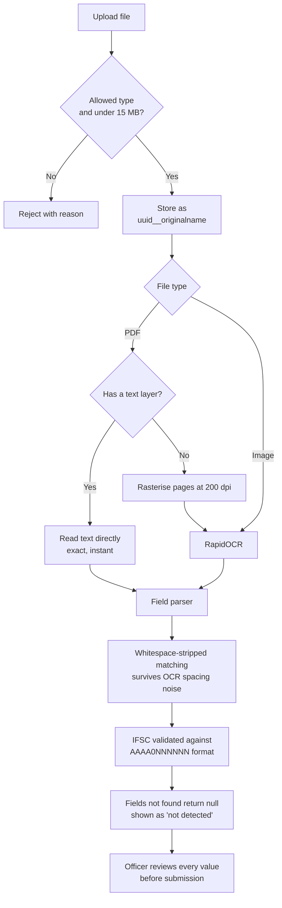
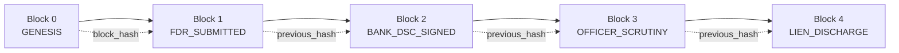

# DepositGuard

**Centralized Security Deposit & FDR Management Portal with Bank Verification**

Smart India Hackathon 2026 · Problem Statement **SIH26265** · Theme: Smart Automation
Team **CODECREWW$** (ID 199121) · Organisation: AICTE, Ministry of Education, Government of India

---

## The problem

Technical institutions seeking AICTE approval must pledge a Fixed Deposit Receipt (FDR)
jointly to the *Member Secretary, AICTE, New Delhi*. Today that process is paper-driven:

| Pain point | Consequence |
|---|---|
| FDR details live across files, letters and spreadsheets | No single, current view of deposit status |
| Submitted FDR details are taken on trust | A lapsed or altered instrument looks identical to a valid one |
| Maturity dates tracked by hand | Deposits silently lapse, leaving students unprotected |
| Release requests move by letter | No auditable record of who approved what |

## What DepositGuard does

1. **One repository** for every institution-wise and instrument-wise deposit record.
2. **Proof from the issuing bank** — the bank digitally signs a confirmation against a
   one-time request, and only bank-confirmed data counts as verified.
3. **Provenance on every field** — each value is tagged `DECLARED`, `BANK_CONFIRMED`,
   `OFFICER_VERIFIED` or `MISMATCH`, so a claim is never confused with a fact.
4. **No-gap renewal** — a maturing FDR cannot close until its replacement is bank-confirmed.
5. **Maker–checker lien release** — two-stage authorisation before any discharge order.
6. **Tamper-evident audit** — every action is SHA-256 hash-chained; altering any row breaks
   the chain and is detected.

---

## System architecture



---

## End-to-end deposit lifecycle



---

## Bank attestation and digital signature



---

## Lien release — maker–checker authorisation



A single officer can never complete a release on their own — the maker and checker
stages are separate authorisations, and both are written into the audit chain.

---

## Document upload and OCR pipeline

Nothing in this pipeline is simulated. Values come from the bytes you upload.



**Why whitespace-stripped matching?** OCR routinely emits `Inte rest`, `AlC TE` and
`BANKOFINDIA`. Label lookups therefore run against a space-free, upper-cased copy of the
text, and AICTE detection tolerates `I`/`l`/`1` and `O`/`0` confusion.

**A field that cannot be found is never guessed.** It returns `null` and is displayed
struck through so the officer knows to enter it manually.

---

## Tamper-evident audit chain



Each block stores `payload_hash`, `previous_hash` and `block_hash`. Editing any row
directly in the database leaves the stored hashes stale, so re-verification pinpoints the
exact block that was altered. The portal includes a tamper-evidence test that demonstrates
this live.

---

## The two roles

| | **AICTE Regulation Bureau Officer** | **Issuing Bank Nodal Officer** |
|---|---|---|
| Login | `aicte_officer` | `bank_officer` |
| Dashboard | Macro view of all deposits, compliance rate, discrepancies | CBS attestation queue |
| Institutions | Registry with per-college document status and declared mismatches | — |
| Registry | Full scrutiny desk with field provenance | Deposits pledged at this bank |
| Renewal | No-gap renewal watch | — |
| Release | Maker–checker sanction desk | Executes CBS lien discharge |
| Notices | Dispatch to bank | Reply to AICTE |
| Audit | Full hash-chained ledger | Full hash-chained ledger |

Both accounts use the password `password123` in the seeded demo database.
Actions are genuinely role-gated server-side — a bank token calling an AICTE-only
endpoint receives `403`.

---

## Tech stack

**Frontend** React 18 · TypeScript · Vite · Tailwind CSS · lucide-react
**Backend** FastAPI · SQLAlchemy · PyJWT (HS256) · Pydantic
**Extraction** RapidOCR (ONNXRuntime) · PyMuPDF
**Storage** SQLite · local document store
**Crypto** SHA-256 hash chain · PBKDF2-HMAC-SHA256 password hashing · pyqrcode

---

## Project structure

```
depositguard/
├── backend/
│   ├── app/
│   │   ├── main.py            # App, middleware, router registration
│   │   ├── models.py          # SQLAlchemy models
│   │   ├── schemas.py         # Pydantic request/response models
│   │   ├── security.py        # JWT, password hashing, DSC attestation
│   │   ├── audit_chain.py     # SHA-256 hash chain
│   │   ├── ocr_engine.py      # Text extraction + field parsing + institution match
│   │   ├── seed_data.py       # Demo seed (runs on first start)
│   │   └── routes/            # auth, fdrs, institutions, bank_portal,
│   │                          # scrutiny, release, documents, audit,
│   │                          # alerts, dashboard, messages
│   └── requirements.txt
├── frontend/
│   └── src/
│       ├── components/        # Views and modals
│       ├── services/api.ts    # API client + token store
│       └── types/             # Shared TypeScript types
├── vercel.json                # Frontend deployment config
└── start.bat / start.ps1      # One-click local launch
```

---

## Running locally

**Prerequisites** Python 3.11+ and Node.js 18+

```bash
# Backend  -> http://localhost:8000   (API docs at /docs)
cd backend
pip install -r requirements.txt
python -m uvicorn app.main:app --reload --port 8000

# Frontend -> http://localhost:5173
cd frontend
npm install
npm run dev
```

On Windows, `start.bat` launches both. The database is created and seeded automatically
on first start; delete `backend/depositguard.db` to reset it.

---

## Selected API endpoints

| Method | Endpoint | Purpose |
|---|---|---|
| `POST` | `/api/auth/login` | Issue JWT |
| `GET` | `/api/fdrs` | List instruments |
| `GET` | `/api/fdrs/{id}/history` | Full dossier: institution, attestations, audit timeline, lineage |
| `POST` | `/api/documents/upload` | Store document, extract text, verify institution |
| `GET` | `/api/institutions/{id}/summary` | Document status + declared mismatches |
| `POST` | `/api/bank/verify` | Bank confirmation with DSC attestation |
| `POST` | `/api/scrutiny/decision` | AICTE scrutiny outcome |
| `POST` | `/api/release/apply` | File a lien release application |
| `POST` | `/api/release/maker-recommend` | Stage 1 authorisation |
| `POST` | `/api/release/checker-approve` | Stage 2 authorisation + discharge order |
| `GET` | `/api/audit/verify` | Re-verify the entire hash chain |

Interactive documentation is served at `/docs`.

---

## Deployment

### Frontend — Vercel

The frontend is a static SPA and deploys cleanly. `frontend/vercel.json` is included.

1. Import this repository at [vercel.com/new](https://vercel.com/new).
2. **Set the Root Directory to `frontend`** — Vercel otherwise detects the FastAPI
   backend as a second service and the build target becomes ambiguous.
3. Add the environment variable `VITE_API_BASE_URL` pointing at your backend's public URL.
4. Deploy.

> **Important:** `VITE_API_BASE_URL` is read at *build* time, not run time. If you add or
> change it, you must redeploy for the new value to take effect. Without it the bundle
> falls back to `http://localhost:8000` and a hosted frontend will not reach any API.

### Backend — *not* Vercel

The backend cannot run on Vercel's serverless platform:

- **RapidOCR + ONNXRuntime and their models exceed** the serverless bundle size limit.
- **SQLite writes do not persist** — serverless filesystems are ephemeral.
- **Uploaded documents would vanish** between invocations.

Host it on a platform with a persistent disk and a normal long-running process —
**Render**, **Railway**, **Fly.io** or any VM:

```bash
pip install -r backend/requirements.txt
uvicorn app.main:app --host 0.0.0.0 --port $PORT
```

Set these environment variables in production:

| Variable | Purpose |
|---|---|
| `DEPOSITGUARD_SECRET_KEY` | **Required.** JWT signing key — never ship the default |
| `PORTAL_BASE_URL` | Public portal URL, so bank QR codes resolve correctly |

For anything beyond a demo, move `allow_origins=["*"]` in `backend/app/main.py` to your
actual frontend origin, and migrate SQLite to PostgreSQL.

---

## Compliance references

- AICTE Approval Process Handbook 2024–27 — security deposit and lock-in norms
- Information Technology Act 2000 — §4 electronic records, §5 digital signatures
- Digital Personal Data Protection Act 2023 — role-based access, audit trails
- RFC 5652 (CMS), RFC 6960 (OCSP) — signature and revocation standards

---

## Status and scope

This is a hackathon prototype. Working end to end: authentication and role gating,
document upload with real OCR extraction, institution matching, bank attestation,
field provenance, maturity scheduling, no-gap renewal, maker–checker lien release,
and the hash-chained audit ledger.

**Not production-ready:** the DSC attestation is a deterministic HMAC stand-in rather than
a real Class-3 certificate chain (which requires licensed CCA certificates and hardware
tokens), and SQLite should be replaced with PostgreSQL before any real deployment.

---

<div align="center">
Built by <b>CODECREWW$</b> for Smart India Hackathon 2026
</div>
