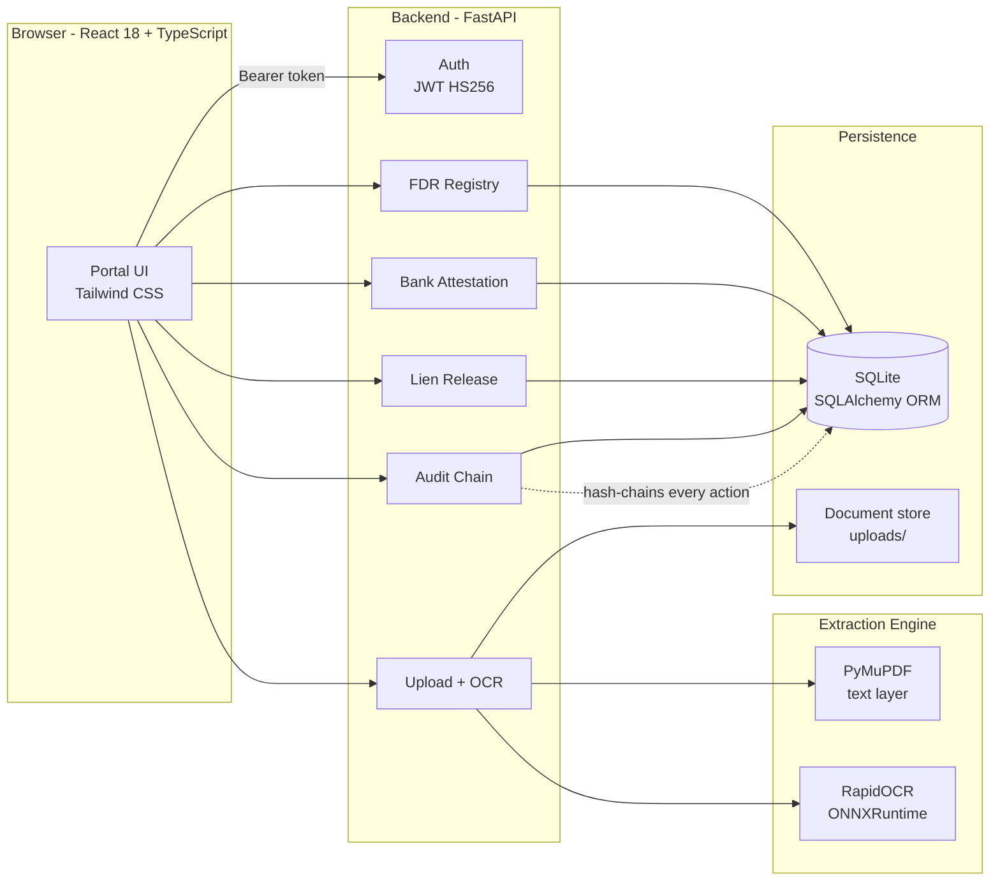
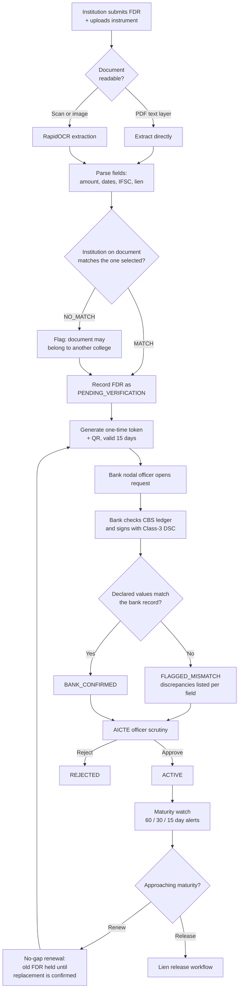
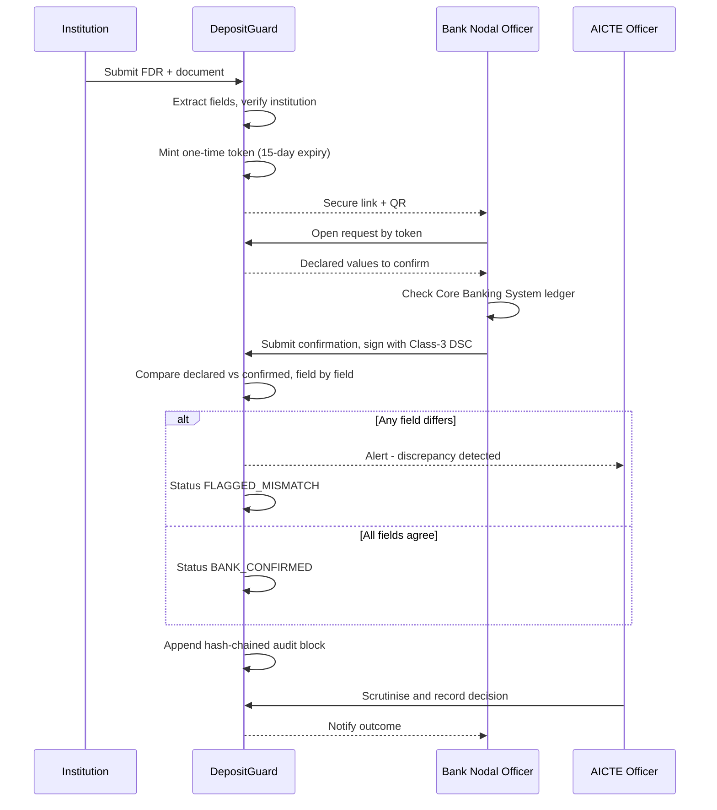
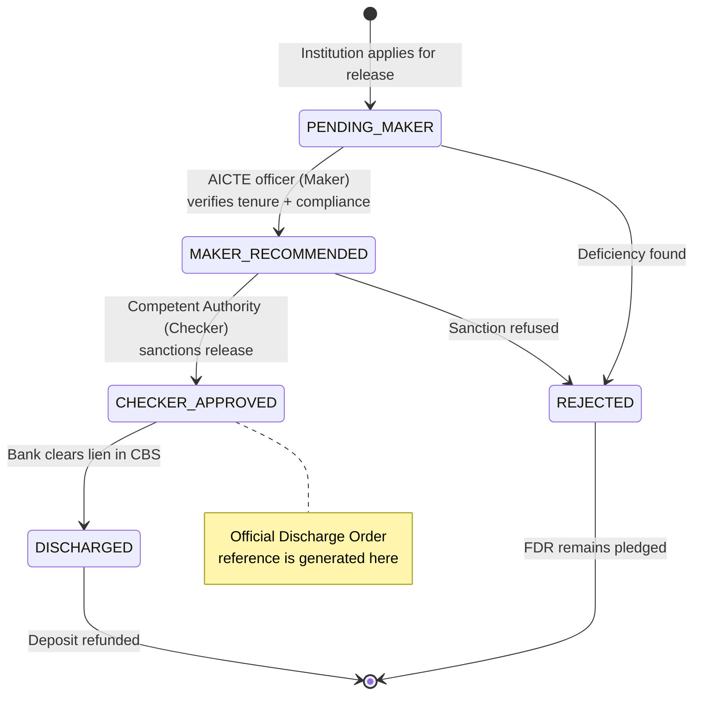
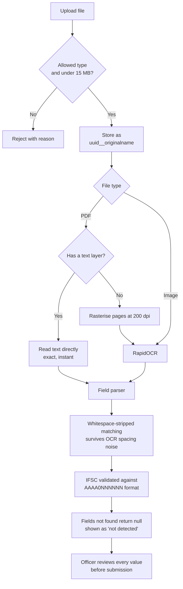
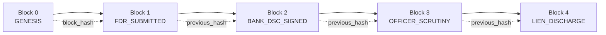

# DepositGuard

**Centralized Security Deposit & FDR Management Portal with Bank Verification**

Smart India Hackathon 2026 · Problem Statement **SIH26265** · Theme: Smart Automation
Team **CODECREWW$** (ID 199121) · Organisation: AICTE, Ministry of Education, Government of India

---

## The problem

Technical institutions seeking AICTE approval must pledge a Fixed Deposit Receipt (FDR)
jointly to the *Member Secretary, AICTE, New Delhi*. Today that process is paper-driven:

| Pain point | Consequence |
|---|---|
| FDR details live across files, letters and spreadsheets | No single, current view of deposit status |
| Submitted FDR details are taken on trust | A lapsed or altered instrument looks identical to a valid one |
| Maturity dates tracked by hand | Deposits silently lapse, leaving students unprotected |
| Release requests move by letter | No auditable record of who approved what |

## What DepositGuard does

1. **One repository** for every institution-wise and instrument-wise deposit record.
2. **Proof from the issuing bank** — the bank digitally signs a confirmation against a
   one-time request, and only bank-confirmed data counts as verified.
3. **Provenance on every field** — each value is tagged `DECLARED`, `BANK_CONFIRMED`,
   `OFFICER_VERIFIED` or `MISMATCH`, so a claim is never confused with a fact.
4. **No-gap renewal** — a maturing FDR cannot close until its replacement is bank-confirmed.
5. **Maker–checker lien release** — two-stage authorisation before any discharge order.
6. **Tamper-evident audit** — every action is SHA-256 hash-chained; altering any row breaks
   the chain and is detected.

---

## System architecture



---

## End-to-end deposit lifecycle



---

# How it works — complete walkthrough

Every check performed from the moment a document is uploaded to the moment the bank
clears the lien, in order. Nothing below is illustrative — each step maps to code in
this repository.

## Stage 1 — Choose the institution

1. The officer opens **Submit New FDR** and types into the institution field.
2. The picker filters the register live on **name, AICTE permanent ID, city or state**.
3. If the college is not on file, **Register "<typed name>" as a new institution**
   opens an inline form (name, AICTE ID, type, city, state, email).
4. `POST /api/institutions` rejects a duplicate **AICTE permanent ID** with `400`.
5. The new institution is selected immediately — no page reload, no losing the form.

## Stage 2 — Upload the instrument

6. The officer picks a file. It is sent to `POST /api/documents/upload` with the
   selected `institution_id` attached.
7. **Authentication gate** — no valid JWT, `401`. Uploading is never anonymous.
8. **Extension check** — only `.pdf .png .jpg .jpeg .webp .tif .tiff .bmp`. Anything
   else is refused with the offending extension named.
9. **Empty-file check** — a zero-byte upload is refused.
10. **Size cap** — over 15 MB is refused with `413` and the actual size reported.
11. **Safe storage** — the original name is stripped to a basename, non-alphanumerics
    are replaced, and the file is written as `<uuid-hex>__<safe-name>`. A caller cannot
    choose the path, overwrite another file, or escape the upload directory.

## Stage 3 — Get text out of the file

12. **PDF?** Open it with PyMuPDF and read the embedded text layer.
13. If that text is **40 characters or longer**, it is a real digital PDF. Use it
    directly: exact characters, no OCR error, effectively instant.
14. If it is shorter, the PDF is a **scan**. Rasterise each page at **200 dpi**
    (first 5 pages) and run OCR over the images.
15. **Image?** Send the bytes straight to OCR.
16. OCR is **RapidOCR on ONNXRuntime** — runs locally, no external API, no key, no data
    leaving the machine. The engine is built once and cached, so only the first call
    pays the model-load cost.
17. The method actually used (`PDF_TEXT_LAYER`, `OCR_SCANNED_PDF`, `OCR_IMAGE`), the
    engine name, page count and mean confidence are all returned and displayed.

## Stage 4 — Parse the fields

OCR output is noisy. It routinely emits `Inte rest`, `AlC TE` and `BANKOFINDIA`.
So **every label lookup runs against a whitespace-stripped, upper-cased copy** of the
text, which makes matching immune to that entire class of error.

18. **IFSC** — matched against the statutory format `AAAA0NNNNNN` (4 letters, a zero,
    6 alphanumerics). Tried label-anchored first (`IFSC:`), then as a bare pattern.
19. **FDR number** — searched after `FDR NO`, `FDR NUMBER`, `FD NO`, `RECEIPT NO`,
    `DEPOSIT NO`, `ACCOUNT NO`.
20. **Label-boundary trimming** — because spaces are stripped, a captured value runs
    into whatever label follows it (`SBI-DEL-2024-778231` + `IFSC`). Each captured
    value is truncated at the first embedded field label.
21. **Amount** — prefers a currency-marked figure (`₹`, `RS`, `INR`); otherwise falls
    back to the largest comma-grouped number. Handles Indian grouping (`35,00,000.00`)
    and repairs OCR-doubled decimal points.
22. **Amount in words** — captured between `RUPEES` and `ONLY` when present.
23. **Dates** — parses `dd/mm/yyyy`, `yyyy-mm-dd` and `10APRIL2024`. Issue and maturity
    are found by their labels; if a label is missing but exactly two dates exist, the
    earliest is treated as issue and the latest as maturity.
24. **Tenure** — read from `N MONTHS` or `N YEARS`; if absent, **derived** from the gap
    between issue and maturity dates.
25. **Interest rate** — first percentage found, sanity-bounded to `0 < rate ≤ 20` so a
    stray number cannot pass as a deposit rate.
26. **Lien and joint holder** — requires both the word `LIEN` and an AICTE mention.
    AICTE detection tolerates the usual OCR confusions (`I`/`l`/`1`, `O`/`0`), so
    `AlC TE` still resolves.
27. **A field that cannot be found returns `null`.** It is shown struck through as
    *not detected*. **The system never invents a value.**

## Stage 5 — Does this document belong to this institution?

28. The extracted text is cross-checked against the institution selected in Stage 1,
    ranked by evidence strength:
    - **AICTE permanent ID present** → `MATCH` (strongest; IDs are unique)
    - **Bracketed acronym present**, e.g. `(VJTI)` → `MATCH`
    - **≥ 60 % of distinctive name words present** → `MATCH`
    - **30–60 %** → `PARTIAL`, verify manually
    - **below 30 %** → `NO_MATCH`
29. Generic words — *Institute, College, Technology, Engineering, National, India* — are
    **excluded** from scoring. They appear in most institution names and would otherwise
    make everything look like a match.
30. The verdict, score and **the exact evidence used** are shown, so an officer can
    overrule the machine rather than trust it blindly.
31. A `NO_MATCH` is **stored with the record** and resurfaces later as a critical
    finding on the institution's compliance report.

## Stage 6 — Officer reviews, then submits

32. Detected values pre-fill the form; undetected ones stay blank.
33. A per-field hit/miss report and the **raw extracted text** are both viewable.
34. **Every value remains editable.** Extraction assists the officer; it never decides.
35. On submit, the record is created with the document reference and the complete
    extraction record attached for audit.

## Stage 7 — Record created, provenance opened

36. A duplicate **FDR receipt number** is rejected with `400`.
37. Status is set to **`PENDING_VERIFICATION`**.
38. Five provenance rows are opened — amount, maturity date, joint holder, lien status,
    issuing bank — each tagged **`DECLARED`**. At this point every value is only a claim.
39. A **cryptographically random one-time token** is minted with a **15-day expiry**.
40. An audit block `FDR_SUBMITTED` is appended to the hash chain.
41. An alert is raised to the AICTE officer.

## Stage 8 — The bank is asked to confirm

42. The token becomes a **secure link and a QR code**, addressed to the issuing bank's
    nodal officer.
43. The bank endpoint is **token-authenticated, not password-authenticated** — the bank
    needs no portal account.
44. Opening the request returns the **declared** values and the institution's details,
    and reports whether the token has expired or was already used.

## Stage 9 — The bank checks its own ledger and signs

45. The nodal officer compares the declared values against the **Core Banking System**
    record and enters what the bank actually holds.
46. The submission is signed, producing a Class-3 DSC attestation record: signer DN,
    issuing CA, certificate serial, timestamp, signature, OCSP status.
47. Signer identity, bank, IFSC and employee ID are all captured with the signature.

## Stage 10 — Field-by-field discrepancy detection

The declared figures are compared against the bank's signed record. **Four checks:**

48. **Amount** — flags `AMOUNT_MISMATCH` if the two differ by more than ₹1 (the
    tolerance absorbs rounding, not shortfalls). Both figures are reported.
49. **Maturity date** — flags `MATURITY_DATE_MISMATCH` on any difference.
50. **Lien** — flags `LIEN_NOT_MARKED` if the bank does **not** confirm a lien in favour
    of the Member Secretary, AICTE. *This is the check that catches an unencumbered
    deposit being passed off as pledged.*
51. **Joint holder** — flags `JOINT_NAME_MISMATCH` if the bank's account title does not
    contain AICTE, quoting the title the bank actually holds.

## Stage 11 — Trust tags are rewritten

52. Each provenance row is updated with the bank's value and re-tagged:
    - agrees with the declaration → **`BANK_CONFIRMED`**
    - disagrees → **`MISMATCH`**, with a note recording the deviation
53. **Only bank-confirmed data counts as verified.** A declaration never promotes itself.

## Stage 12 — Outcome of attestation

54. **Any discrepancy** → status **`FLAGGED_MISMATCH`**, every discrepancy listed, and a
    **critical** alert raised to the AICTE officer.
55. **Clean, and this is a renewal** → the replaced FDR is marked `RENEWED` and the new
    one goes **`ACTIVE`**, completing the no-gap handover.
56. **Clean, first submission** → **`BANK_CONFIRMED`**, awaiting officer scrutiny.
57. An audit block `BANK_DSC_CONFIRMATION_SIGNED` records the certificate serial,
    issuer and the discrepancy count.

## Stage 13 — AICTE officer scrutiny

58. The officer sees declared and bank-confirmed values **side by side** with trust tags.
59. Three decisions, each requiring the officer's role (`403` otherwise):
    **Approve → `ACTIVE`**, **Flag → `FLAGGED_MISMATCH`**, **Reject → `REJECTED`**.
60. On approval every provenance row is promoted to **`OFFICER_VERIFIED`**.
61. The decision, remarks and the officer's identity are hash-chained, and the bank is
    notified of the outcome.

## Stage 14 — Maturity watch

62. The scheduler evaluates every live instrument and computes days to maturity.
63. Alerts fire at **60 / 30 / 15 days**, escalating `INFO → WARNING → CRITICAL`.
64. At **0 days** the instrument becomes `MATURED` and is reported as a lapse in cover.
65. Duplicate alerts for the same instrument on the same day are suppressed.

## Stage 15 — No-gap renewal

66. A replacement FDR is filed against the maturing one; both are linked as a lineage.
67. The old instrument moves to `RENEWAL_IN_PROGRESS` — **it is not closed**.
68. **The old FDR is released only once the replacement is bank-confirmed** (step 55).
    There is no window in which the institution is uncovered.
69. The full renewal chain is preserved and displayed as *generation N of M*.

## Stage 16 — Release and refund, under maker–checker

70. The institution applies for release, stating the ground (tenure complete, etc.).
71. A second application on an already-pending instrument is refused.
72. **Stage 1 — Maker:** an AICTE officer verifies tenure and compliance, and either
    recommends or rejects.
73. **Stage 2 — Checker:** the Competent Authority sanctions or refuses. Only here is an
    **official Lien Discharge Order reference** generated.
74. Both stages require the AICTE role, and both are hash-chained with the officer's
    identity and remarks. **One person cannot complete a release alone.**
75. A printable Government-of-India-format discharge order is rendered for the bank.

## Stage 17 — The bank clears the lien — end result

76. The bank can execute a discharge **only when the release is `CHECKER_APPROVED`** —
    attempting it earlier is refused. A bank cannot release a deposit on its own say-so.
77. The bank clears the lien in CBS. The instrument becomes **`RELEASED`** and the
    lien provenance row is updated to *Lien Discharged / Cleared*.
78. `BANK_LIEN_DISCHARGE_EXECUTED` is hash-chained against the discharge order.
79. The AICTE officer is notified that the cycle is complete. **The deposit is refunded
    and the lifecycle closes.**

## Running throughout — the audit chain

80. Every submission, attestation, scrutiny decision, renewal, sanction, discharge and
    official notice is appended as a block holding `payload_hash`, `previous_hash` and
    `block_hash`.
81. Editing any row directly in the database leaves the stored hashes stale, so
    re-verification names **the exact block** that was altered.
82. The portal ships a tamper-evidence test that demonstrates this live.

## Running throughout — institution compliance

Any institution can be opened for a consolidated position. **Ten checks** are declared
per instrument, each with severity, a code and a plain-English explanation:

| Code | Severity | Raised when |
|---|---|---|
| `AMOUNT_MISMATCH` | Critical | Declared and bank-confirmed principal differ |
| `LIEN_NOT_MARKED` | Critical | Bank confirms no AICTE lien — deposit is unencumbered |
| `JOINT_HOLDER_MISMATCH` | Critical | AICTE absent from the bank's account title |
| `FLAGGED_INSTRUMENT` | Critical | Flagged during scrutiny |
| `DOCUMENT_INSTITUTION_MISMATCH` | Critical | Uploaded document names a different college |
| `MATURED_NOT_RENEWED` | Critical | Matured with no bank-confirmed replacement |
| `MISSING_DOCUMENT` | Warning | No source instrument on file |
| `MATURITY_MISMATCH` | Warning | Declared and bank maturity dates differ |
| `PROVENANCE_MISMATCH` | Warning | Any field disagrees with the bank record |
| `EXPIRING_SOON` | Warning | Matures within 60 days |
| `AWAITING_BANK_VERIFICATION` | Info | Not yet DSC-attested |

The institution is then rated **Compliant**, **Attention Required** or **Non-Compliant**,
alongside document-upload coverage, bank-verification coverage, declared-versus-confirmed
totals and live deposit cover.

---

## Bank attestation and digital signature



---

## Lien release — maker–checker authorisation



A single officer can never complete a release on their own — the maker and checker
stages are separate authorisations, and both are written into the audit chain.

---

## Document upload and OCR pipeline

Nothing in this pipeline is simulated. Values come from the bytes you upload.



**Why whitespace-stripped matching?** OCR routinely emits `Inte rest`, `AlC TE` and
`BANKOFINDIA`. Label lookups therefore run against a space-free, upper-cased copy of the
text, and AICTE detection tolerates `I`/`l`/`1` and `O`/`0` confusion.

**A field that cannot be found is never guessed.** It returns `null` and is displayed
struck through so the officer knows to enter it manually.

---

## Tamper-evident audit chain



Each block stores `payload_hash`, `previous_hash` and `block_hash`. Editing any row
directly in the database leaves the stored hashes stale, so re-verification pinpoints the
exact block that was altered. The portal includes a tamper-evidence test that demonstrates
this live.

---

## The two roles

| | **AICTE Regulation Bureau Officer** | **Issuing Bank Nodal Officer** |
|---|---|---|
| Login | `aicte_officer` | `bank_officer` |
| Dashboard | Macro view of all deposits, compliance rate, discrepancies | CBS attestation queue |
| Institutions | Registry with per-college document status and declared mismatches | — |
| Registry | Full scrutiny desk with field provenance | Deposits pledged at this bank |
| Renewal | No-gap renewal watch | — |
| Release | Maker–checker sanction desk | Executes CBS lien discharge |
| Notices | Dispatch to bank | Reply to AICTE |
| Audit | Full hash-chained ledger | Full hash-chained ledger |

Both accounts use the password `password123` in the seeded demo database.
Actions are genuinely role-gated server-side — a bank token calling an AICTE-only
endpoint receives `403`.

---

## Tech stack

**Frontend** React 18 · TypeScript · Vite · Tailwind CSS · lucide-react
**Backend** FastAPI · SQLAlchemy · PyJWT (HS256) · Pydantic
**Extraction** RapidOCR (ONNXRuntime) · PyMuPDF
**Storage** SQLite · local document store
**Crypto** SHA-256 hash chain · PBKDF2-HMAC-SHA256 password hashing · pyqrcode

---

## Project structure

```
depositguard/
├── backend/
│   ├── app/
│   │   ├── main.py            # App, middleware, router registration
│   │   ├── models.py          # SQLAlchemy models
│   │   ├── schemas.py         # Pydantic request/response models
│   │   ├── security.py        # JWT, password hashing, DSC attestation
│   │   ├── audit_chain.py     # SHA-256 hash chain
│   │   ├── ocr_engine.py      # Text extraction + field parsing + institution match
│   │   ├── seed_data.py       # Demo seed (runs on first start)
│   │   └── routes/            # auth, fdrs, institutions, bank_portal,
│   │                          # scrutiny, release, documents, audit,
│   │                          # alerts, dashboard, messages
│   └── requirements.txt
├── frontend/
│   └── src/
│       ├── components/        # Views and modals
│       ├── services/api.ts    # API client + token store
│       └── types/             # Shared TypeScript types
├── vercel.json                # Frontend deployment config
└── start.bat / start.ps1      # One-click local launch
```

---

## Running locally

**Prerequisites** Python 3.11+ and Node.js 18+

```bash
# Backend  -> http://localhost:8000   (API docs at /docs)
cd backend
pip install -r requirements.txt
python -m uvicorn app.main:app --reload --port 8000

# Frontend -> http://localhost:5173
cd frontend
npm install
npm run dev
```

On Windows, `start.bat` launches both. The database is created and seeded automatically
on first start; delete `backend/depositguard.db` to reset it.

---

## Selected API endpoints

| Method | Endpoint | Purpose |
|---|---|---|
| `POST` | `/api/auth/login` | Issue JWT |
| `GET` | `/api/fdrs` | List instruments |
| `GET` | `/api/fdrs/{id}/history` | Full dossier: institution, attestations, audit timeline, lineage |
| `POST` | `/api/documents/upload` | Store document, extract text, verify institution |
| `GET` | `/api/institutions/{id}/summary` | Document status + declared mismatches |
| `POST` | `/api/bank/verify` | Bank confirmation with DSC attestation |
| `POST` | `/api/scrutiny/decision` | AICTE scrutiny outcome |
| `POST` | `/api/release/apply` | File a lien release application |
| `POST` | `/api/release/maker-recommend` | Stage 1 authorisation |
| `POST` | `/api/release/checker-approve` | Stage 2 authorisation + discharge order |
| `GET` | `/api/audit/verify` | Re-verify the entire hash chain |

Interactive documentation is served at `/docs`.

---

## Deployment

### Frontend — Vercel

The frontend is a static SPA and deploys cleanly. `frontend/vercel.json` is included.

1. Import this repository at [vercel.com/new](https://vercel.com/new).
2. **Set the Root Directory to `frontend`** — Vercel otherwise detects the FastAPI
   backend as a second service and the build target becomes ambiguous.
3. Add the environment variable `VITE_API_BASE_URL` pointing at your backend's public URL.
4. Deploy.

> **Important:** `VITE_API_BASE_URL` is read at *build* time, not run time. If you add or
> change it, you must redeploy for the new value to take effect. Without it the bundle
> falls back to `http://localhost:8000` and a hosted frontend will not reach any API.

### Backend — *not* Vercel

The backend cannot run on Vercel's serverless platform:

- **RapidOCR + ONNXRuntime and their models exceed** the serverless bundle size limit.
- **SQLite writes do not persist** — serverless filesystems are ephemeral.
- **Uploaded documents would vanish** between invocations.

Host it on a platform with a persistent disk and a normal long-running process —
**Render**, **Railway**, **Fly.io** or any VM:

```bash
pip install -r backend/requirements.txt
uvicorn app.main:app --host 0.0.0.0 --port $PORT
```

Set these environment variables in production:

| Variable | Purpose |
|---|---|
| `DEPOSITGUARD_SECRET_KEY` | **Required.** JWT signing key — never ship the default |
| `PORTAL_BASE_URL` | Public portal URL, so bank QR codes resolve correctly |

For anything beyond a demo, move `allow_origins=["*"]` in `backend/app/main.py` to your
actual frontend origin, and migrate SQLite to PostgreSQL.

---

## Compliance references

- AICTE Approval Process Handbook 2024–27 — security deposit and lock-in norms
- Information Technology Act 2000 — §4 electronic records, §5 digital signatures
- Digital Personal Data Protection Act 2023 — role-based access, audit trails
- RFC 5652 (CMS), RFC 6960 (OCSP) — signature and revocation standards

---

## Status and scope

This is a hackathon prototype. Working end to end: authentication and role gating,
document upload with real OCR extraction, institution matching, bank attestation,
field provenance, maturity scheduling, no-gap renewal, maker–checker lien release,
and the hash-chained audit ledger.

**Not production-ready:** the DSC attestation is a deterministic HMAC stand-in rather than
a real Class-3 certificate chain (which requires licensed CCA certificates and hardware
tokens), and SQLite should be replaced with PostgreSQL before any real deployment.

---

<div align="center">
Built by <b>CODECREWW$</b> for Smart India Hackathon 2026
</div>
